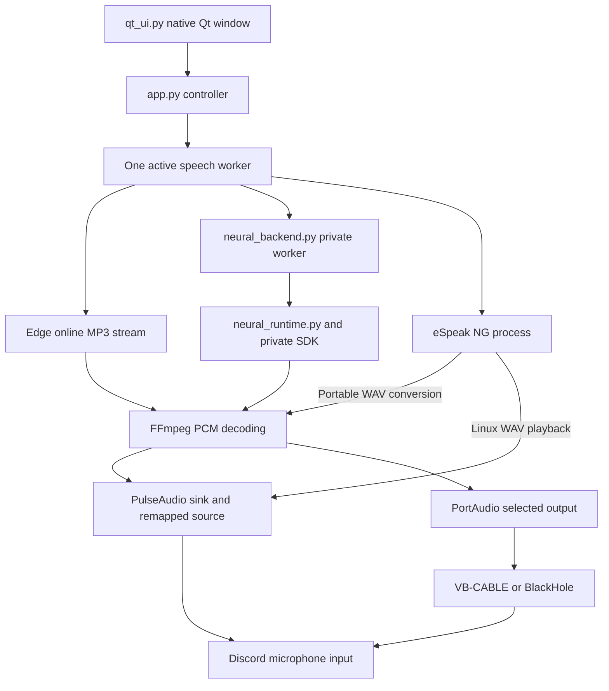

# Architecture

Discord TTS GUI is a local desktop application. Discord consumes its audio as
an operating system microphone; the app does not use Discord tokens or APIs.
The application modules remain at the repository root so source launchers,
Debian packaging and frozen desktop builds share the same imports.

## Module boundaries

| Module | Responsibility |
| --- | --- |
| `app.py` | Controller, request lifecycle, online provider, Linux audio routing and startup |
| `qt_ui.py` | Qt widgets and adapters used by the controller; PyQt6 with PyQt5 fallback |
| `desktop_ui.py` | Legacy Tk layout and compatibility tests |
| `portable_audio.py` | Explicit PortAudio device selection and bounded PCM output |
| `portable_playback.py` | Portable decoding, streaming and cancellation |
| `neural_backend.py` | Private runtime setup, resident worker protocol and process cleanup |
| `neural_runtime.py` | SDK-facing subprocess and offline network guard |
| `neural_model_files.py` | Safe regular-file copies of ONNX graphs and external weights |
| `neural_playback.py` | Linux neural PCM playback through FFmpeg and paplay |
| `media_tools.py` | Native tool lookup and platform subprocess options |
| `runtime_support.py` | Platform-specific user data, state and interpreter paths |

Normal startup constructs `QtRoot`. The controller also accepts the Tk root
used by legacy widget tests. Workers report through a queue; the UI event loop
owns widget updates and polls that queue.

## Speech lifecycle

The controller permits one active speech worker and one pending request.
Another Speak action replaces the pending request, cancels active work and
starts the latest request only after the previous worker exits. User changes
to engine or voice restart active speech with the current editor contents.
Typing alone never sends speech or makes a network request.

Each speech request has a generation number. Events from replaced generations
are ignored, so an old completion cannot reset a newer request's UI state.
Stop, audio removal and close clear pending work and advance the generation.
Device removal and window destruction wait for worker cleanup.

Streaming queues are bounded. Online MP3 chunks reach FFmpeg before the entire
response completes. Linux playback uses paplay; portable playback supplies
48 kHz stereo signed 16-bit PCM to PortAudio callbacks. Cancellation must
unblock providers, decoders and consumers, including before first audio.

## Optional neural runtime

VieNeu uses SDK version `3.8.4` in a private environment under
`neural/v3turbo-onnx-fp32` in the user data directory. Download/repair is an
explicit action. Ordinary startup and Speak never provision dependencies or
download missing models. A readiness manifest is accepted only with the
expected SDK version, usable voices and successful offline verification.

Source installs bootstrap with the current Python interpreter's `venv` module.
Frozen builds use bundled uv to provision managed Python 3.12. External worker
sources live in `_MEIPASS/workers`, away from bundled native extensions.
Worker environment construction removes caller Python overrides and restores
external library search paths. POSIX process groups and Windows Job Objects
make cancellation cover descendants.

The runtime speaks JSON lines over standard input/output and sends diagnostic
output to standard error. The resident offline worker loads CPU ONNX fp32
models, verifies 48 kHz output and streams PCM. Stop releases that worker.
Hub snapshot symlinks are materialized into private regular files before ONNX
loading; the original download cache remains reusable.

## Audio ownership

Linux creates a temporary null sink and remapped microphone. Cleanup unloads
only module IDs owned by the controller. Preview and physical microphone
mixing use optional loopbacks. Windows/macOS connect to an explicitly selected
installed virtual driver; disconnect never removes that driver. Portable
preview uses a separately selected output; physical microphone mixing requires
an external mixer on those platforms. No route changes system defaults.

See [product contracts](./product.md), [testing](./testing.md) and the
[desktop boundaries decision](./decisions/0001-desktop-boundaries.md).
